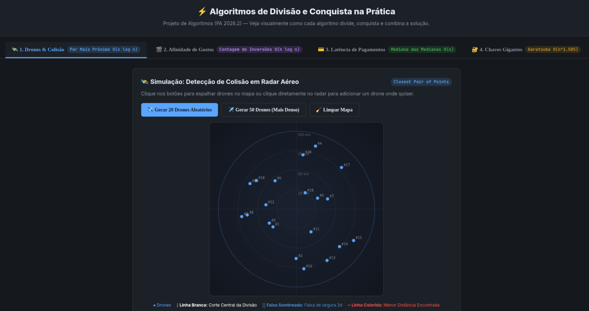

# ⚡ OmniDivide — Aplicações de Divisão e Conquista no Mundo Real

Sistema interativo que aplica **4 Algoritmos Clássicos de Divisão e Conquista** a problemas reais de engenharia de software, logística urbana, fintechs e segurança de dados.

## 👥 Integrantes

| Nome | Matrícula |
|---|---|
| Davi Rodrigues Nunes | 232014413 |
| Marcos Filho Pereira Quixabeira | 232005343 |

---

## 📦 Algoritmos Implementados

| Módulo | Problema Real | Algoritmo | Complexidade |
|---|---|---|---|
| 🛰️ **Radar de Drones** | Detecção de risco de colisão em frotas de drones autônomos e aeronaves | **Par de Pontos Mais Próximo** (*Closest Pair*) | $O(n \log n)$ |
| 🎬 **Recomendador de Conteúdo** | Medir a compatibilidade de gostos entre perfis de usuários (estilo Spotify/Netflix) | **Contagem de Inversões** (*Merge Sort modificado*) | $O(n \log n)$ |
| 💳 **Monitor de SLA & Pagamentos** | Monitoramento de latência e SLAs em transações bancárias (PIX/Cartão) imune a picos de DDoS | **Mediana das Medianas** (*Blum-Floyd-Pratt-Rivest-Tarjan*) | $O(n)$ |
| 🔐 **Chaves Criptográficas** | Multiplicação rápida de números com centenas de dígitos em módulos de segurança (HSMs) | **Multiplicação de Karatsuba** | $O(n^{1.585})$ |

---

## 📸 Screenshots

| Radar de Drones & Detecção de Colisão em Tempo Real |
|:---:|
|  |

---

## 🎥 Vídeo de Apresentação

O vídeo de apresentação e demonstração do projeto pode ser assistido no YouTube:

👉 [Assistir à Apresentação do Projeto](https://youtu.be/SEU_LINK_DO_VIDEO_AQUI)

> *(Espaço reservado para o link do vídeo de apresentação da dupla)*

---

## 🚀 Como Executar

### Pré-requisitos
- Python 3.10 ou superior instalado.

### Passo a Passo

```bash
# 1. Acesse a pasta do projeto
cd trabalho3

# 2. Crie um ambiente virtual (recomendado)
python3 -m venv venv

# 3. Ative o ambiente virtual
# No Linux/macOS:
source venv/bin/activate
# No Windows:
# venv\Scripts\activate

# 4. Instale as dependências (Flask)
pip install -r requirements.txt

# 5. Inicie o servidor
python3 app.py
```

Após iniciar, abra no navegador:  
👉 **[http://localhost:5000](http://localhost:5000)**

> **Dica de Navegação:** Use as teclas numéricas `1`, `2`, `3` ou `4` no teclado para alternar instantaneamente entre os 4 módulos interativos!

---

## 🧪 Testes Automatizados

O projeto inclui uma suíte completa de testes unitários e de integração utilizando o módulo nativo `unittest` do Python (sem dependências externas):

```bash
# A partir da pasta do projeto
cd trabalho3

# Executa todos os testes unitários e de integração
python3 -m unittest discover tests -v
```

A suíte cobre:
- **Corretude dos 4 Algoritmos:** validação contra métodos de força bruta $O(n^2)$ e funções de referência.
- **Casos de Borda:** listas vazias, listas unitárias, elementos duplicados, valores negativos e inteiros com centenas de dígitos.
- **Validação de Contratos da API:** verificação de status code 200/400 e integridade das respostas JSON.

---

## 🎨 Tecnologias Utilizadas

- **Backend:** Python 3 + Flask (APIs REST leves e determinísticas para execução dos algoritmos).
- **Frontend:** HTML5 semântico, CSS3 (Vanilla com Dark Mode limpo) e JavaScript Vanilla.
- **Gráficos & Renderização:** HTML5 Canvas 2D (Radar aéreo com visualização da linha de corte e faixa central $2d$, e histograma dinâmico de latência).
- **Sem frameworks pesados:** Código enxuto, sem dependências externas complexas de frontend.

---

## 🔍 Como os Algoritmos Funcionam (Divisão e Conquista)

Cada módulo do projeto ilustra visualmente os três passos fundamentais do paradigma:

1. **Par de Pontos Mais Próximo ($O(n \log n)$):**
   - **Divisão:** Ordena os pontos por $X$ e corta o plano ao meio com uma linha vertical.
   - **Conquista:** Acha recursivamente a menor distância na esquerda ($d_L$) e na direita ($d_R$).
   - **Combinação:** Analisa apenas os pontos que estão dentro da faixa central de largura $2d$. Nessa faixa, o teorema matemático garante que cada ponto precisa ser comparado com no máximo 7 vizinhos ordenados por $Y$.

2. **Contagem de Inversões ($O(n \log n)$):**
   - **Divisão:** Divide o vetor de preferências sucessivamente ao meio até listas unitárias.
   - **Conquista:** Conta as inversões recursivamente em cada metade usando a estrutura do Merge Sort.
   - **Combinação:** Durante a intercalação das metades ordenadas, quando um elemento da direita é puxado antes da esquerda, somamos todas as inversões restantes da esquerda em apenas $O(1)$.

3. **Mediana das Medianas ($O(n)$):**
   - **Divisão:** Divide a lista de transações em blocos de 5 elementos.
   - **Conquista:** Encontra a mediana de cada bloco em $O(1)$ e chama a si mesmo para achar a mediana dessas medianas.
   - **Combinação:** Usa esse valor como pivô perfeito para particionar a lista. O pivô descarta com certeza pelo menos $30\%$ dos dados a cada rodada, garantindo tempo estritamente linear sem o risco de $O(n^2)$ do QuickSelect.

4. **Multiplicação de Karatsuba ($O(n^{1.585})$):**
   - **Divisão:** Divide números de $n$ dígitos em duas metades (alta e baixa).
   - **Conquista & Combinação:** Em vez de fazer as 4 multiplicações escolares ($O(n^2)$), calcula apenas 3 multiplicações recursivas ($z_0$, $z_2$ e o produto das somas), reaproveitando os resultados para obter o termo do meio com simples subtrações. A complexidade cai para $n^{\log_2 3} \approx n^{1.585}$.

---

## 📚 Contexto Acadêmico

Projeto desenvolvido para a disciplina de **Projeto de Algoritmos (PA)** — FGA / UnB.  
**Módulo:** Divisão e Conquista (D&C).  
O objetivo é fornecer uma ferramenta visual, interativa e didática que comprove na prática a eficiência assintótica e as vantagens matemáticas da técnica de Divisão e Conquista frente aos métodos ingênuos de força bruta.
